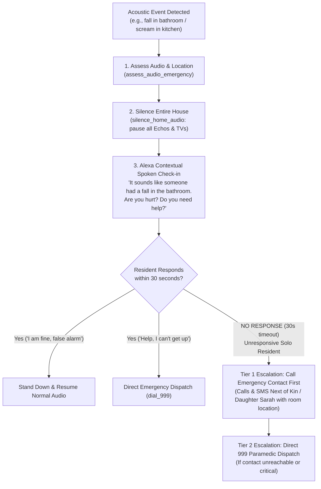

# Alexa Home Health Triage 🚑

An intelligent ambient acoustic triage system built as a local **Model Context Protocol (MCP)** server for smart home ecosystems (such as Amazon Alexa) and ambient health monitoring agents.

When household microphones detect alarming sounds—such as a child screaming, a fall in the bathroom, or a loud crash—this MCP server coordinates acoustic triage, mutes household audio for emergency communication, speaks contextual check-ins, and manages an **Unresponsive Solo Resident Escalation Protocol**.

---

## 🌟 The Complete Emergency Workflow



---

## 🛠️ MCP Tools Exposed

Under the `HomeHealthTriage` namespace, the server registers 4 custom tools:

### 1. `assess_audio_emergency`
- **Description**: Evaluates acoustic events and room location, calculates medical triage priority (`CRITICAL`, `HIGH`, `MEDIUM`, `LOW`), formulates spoken Alexa dialogue, and sets unresponsive timeout limits.
- **Input Parameters**:
  - `audio_event` (string, required): Acoustic event description (e.g. `'child screaming'`, `'fall detected'`, `'loud crash'`).
  - `location` (string, optional): Room/zone where detected (e.g. `'kitchen'`, `'bathroom'`, `'stairs'`).
  - `is_home_alone` (boolean, optional, default: `true`): Activates the unresponsive escalation timer.

### 2. `silence_home_audio`
- **Description**: Immediately pauses media playback across all household Echo devices (Kitchen, Living Room, Bedroom, Bathroom, Hallway) so the emergency announcement is heard clearly without background interference.
- **Input Parameters**:
  - `reason` (string, required): e.g. `'Emergency triage initiated in kitchen'`.

### 3. `escalate_unresponsive_resident`
- **Description**: Handles solo residents who fail to respond to Alexa's check-in within the timeout window. Executes Tier 1 (dials designated emergency contact/family) and readies Tier 2 (emergency services 999).
- **Input Parameters**:
  - `location` (string, required): Room of the incident.
  - `audio_event` (string, required): Acoustic event.
  - `seconds_unresponsive` (number, optional, default `30`): Timeout duration without vocal reply.
  - `emergency_contact_name` (string, optional, default `'Sarah (Daughter)'`).
  - `emergency_contact_phone` (string, optional, default `'+44 7700 900123'`).

### 4. `dispatch_medical_alert`
- **Description**: Direct dispatch execution tool via specified contact channels (e.g. `'dial_999'`, `'intercom_parent'`).

---

## 📋 Prerequisites

- **Node.js**: `v18.0.0` or higher
- **npm**: `v9.0.0` or higher

---

## 🚀 Quick Start & Installation

1. **Clone the repository**:
   ```bash
   git clone https://github.com/temietech/alexa-health-triage.git
   cd alexa-health-triage
   ```

2. **Install dependencies**:
   ```bash
   npm install
   ```

3. **Start the MCP Server**:
   ```bash
   npm start
   ```

---

## 🔍 Testing & Evaluation (For Judges)

This project runs as a local Node.js **Model Context Protocol (MCP)** server communicating over standard `stdio`. Judges can evaluate every phase of the triage pipeline locally:

### 1. Evaluate `assess_audio_emergency` (Standard Evaluation)
```bash
node -e "import('./server.js').then(async ({ server }) => { const result = await server._registeredTools['assess_audio_emergency'].handler({ audio_event: 'loud crash' }); console.log(JSON.stringify(result, null, 2)); process.exit(0); })"
```

### 2. Evaluate Room-Aware Triage ('child screaming in kitchen')
```bash
node -e "import('./server.js').then(async ({ server }) => { const result = await server._registeredTools['assess_audio_emergency'].handler({ audio_event: 'child screaming', location: 'kitchen' }); console.log(JSON.stringify(result, null, 2)); process.exit(0); })"
```

### 3. Evaluate Housewide Audio Silencing
```bash
node -e "import('./server.js').then(async ({ server }) => { const result = await server._registeredTools['silence_home_audio'].handler({ reason: 'Emergency check-in for screaming in kitchen' }); console.log(JSON.stringify(result, null, 2)); process.exit(0); })"
```

### 4. Evaluate Solo Resident Unresponsive Protocol (30s Fall in Bathroom)
```bash
node -e "import('./server.js').then(async ({ server }) => { const result = await server._registeredTools['escalate_unresponsive_resident'].handler({ location: 'bathroom', audio_event: 'fall detected', seconds_unresponsive: 30 }); console.log(JSON.stringify(result, null, 2)); process.exit(0); })"
```

### 5. Interactive Testing via MCP Inspector

Launch the official web interface:
```bash
npx @modelcontextprotocol/inspector node server.js
```
Open the generated local URL to inspect tools, submit parameters interactively, and view live JSON-RPC messages.

---

## ⚙️ MCP Client Configuration

To connect this server with Claude Desktop or custom MCP host agents, add this entry to `claude_desktop_config.json`:

```json
{
  "mcpServers": {
    "HomeHealthTriage": {
      "command": "node",
      "args": ["/path/to/alexa-health-triage/server.js"]
    }
  }
}
```

---

## 📄 License

ISC License. See [package.json](package.json).
